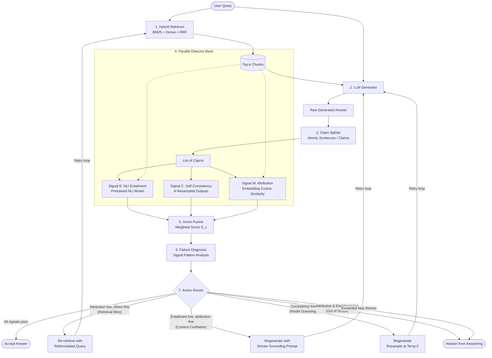

# RAGuard

**A training-free hallucination detection and mitigation layer that sits on top of a Retrieval-Augmented Generation (RAG) pipeline, diagnoses WHY an answer is unsupported, and takes a failure-specific corrective action.**

---

## 1. Overview

Retrieval-Augmented Generation (RAG) pairs large language models (LLMs) with external knowledge retrieval to produce grounded answers. While RAG substantially reduces hallucinations compared to closed-book generation, it does not eliminate them. Even when relevant evidence is retrieved, an LLM can still fail in four distinct ways:

1. **Adding unsupported details:** Introducing entities or assertions absent from the retrieved passages.
2. **Conflating facts:** Merging facts across multiple retrieved chunks into incorrect combinations.
3. **Fabricating answers under retrieval failure:** Producing hallucinated responses when retrieved evidence fails to cover the query.
4. **Intruding parametric memory:** Overriding retrieved context with outdated or incorrect memorized training data.

Most deployed RAG systems return the generated answer to the user regardless of grounding, providing no confidence signal, failure diagnosis, or corrective fallback.

### What RAGuard Is
- **A verification and mitigation layer:** An inspection module inserted between generation and delivery that verifies individual claims against retrieved evidence, diagnoses the likely failure mode, and triggers a targeted mitigation.
- **A lightweight baseline RAG pipeline:** A minimal retrieval and generation harness upon which the verification layer operates.
- **An evaluation harness:** An automated benchmarking suite to evaluate claim verification accuracy, diagnosis precision, and mitigation effectiveness across public and custom datasets.
- **An optional demonstration interface:** A web UI with an interactive RAGuard ON/OFF comparison toggle.

### What RAGuard Is NOT
- **No model training or fine-tuning:** We are **NOT** training a new foundation model, and we are **NOT** fine-tuning any model. All models used—the Natural Language Inference (NLI) model, dense embedding model, and generator LLM—are pretrained, off-the-shelf components.
- **Systems and empirical contribution:** RAGuard is an architectural and empirical contribution, not a new low-level detection algorithm. Our contribution lies in the **composition** of multi-signal verification, the **pattern-based failure diagnosis**, and the **diagnosis-conditioned routing logic**.

---

## 2. Architecture

RAGuard intercepts the standard RAG pipeline immediately after answer generation. It decomposes answers into atomic claims, extracts three orthogonal validation signals in parallel, diagnoses the root cause of any failure, and executes a bounded corrective loop.



### Stage-by-Stage Pipeline

#### 1. Hybrid Retriever
- **Input:** Raw user query string.
- **Mechanism:** Dual-track retrieval combining sparse lexical search (`rank_bm25`) and dense semantic search (`sentence-transformers` with FAISS/Qdrant), combined via Reciprocal Rank Fusion (RRF).
- **Output:** Top-$k$ ranked context chunks.

#### 2. LLM Generator
- **Input:** User query and retrieved top-$k$ context chunks formatted within a prompt.
- **Mechanism:** Prompted instruction generation via an OpenAI-compatible API or local LLM.
- **Output:** Initial candidate answer string.

#### 3. Claim Splitter
- **Input:** Candidate answer string.
- **Mechanism:** Breaks multi-sentence text into individual claims. Uses spaCy sentence segmentation as the deterministic baseline, with LLM-based atomic claim decomposition planned as an advanced variant.
- **Output:** List of atomic claim strings $\{c_1, c_2, \dots, c_m\}$.

#### 4. Parallel Detector Bank
Runs three complementary verification signals across every atomic claim $c$:

- **Signal E — NLI Entailment:**
  - *What it does:* Measures formal logical entailment between the retrieved context and claim $c$ using a pretrained cross-encoder NLI model (returning probabilities for `entailment`, `neutral`, `contradiction`).
  - *Context chunking:* If a context chunk exceeds the NLI model's maximum sequence length, it is split into overlapping windows, taking the maximum entailment probability across sub-chunks.
  - *Catches:* Direct contradictions, conflations across passages, and unsupported factual assertions.

- **Signal C — Self-Consistency:**
  - *What it does:* Prompts the generator to produce $N$ alternative candidate answers at an elevated temperature ($T=0.7$). Measures semantic similarity between claim $c$ and the resampled answers (inspired by SelfCheckGPT).
  - *Catches:* Hallucinations driven by model guessing or unstable parametric uncertainty.

- **Signal M — Attribution (Semantic Match):**
  - *What it does:* Calculates the maximum cosine similarity between the dense embedding of claim $c$ and each retrieved context chunk.
  - *Catches:* Claims having no lexical or semantic overlap with any retrieved text (unanchored statements).

#### 5. Score Fusion
- **Input:** Signal triplet $(E(c), M(c), C(c))$ for each claim $c$.
- **Mechanism:** Computes a composite grounding score:
  $$S(c) = w_1 \cdot E(c) + w_2 \cdot M(c) + w_3 \cdot C(c)$$
  Initial baseline uses uniform weights ($w_1 = w_2 = w_3 = \frac{1}{3}$). Weights will subsequently be calibrated via logistic regression on the validation split.
- **Output:** Numerical grounding score $S(c) \in [0, 1]$ and boolean pass/fail status per signal against calibrated thresholds $(\tau_E, \tau_M, \tau_C)$.

#### 6. Failure Diagnosis
- **Input:** Pass/fail pattern across the individual signals $(E, M, C)$ rather than a collapsed scalar score.
- **Mechanism:** Maps the distinct signal signature to the most probable failure root cause.
- **Output:** Diagnosed failure category (Retrieval Miss, Context Conflation, Model Guessing, Out of Scope, or Verified Grounded).

#### 7. Action Router
- **Input:** Diagnosed failure category and current retry budget.
- **Mechanism:** Dispatches a targeted corrective action. Retries are strictly bounded by a maximum retry limit ($K \le 2$). Every iteration logs latency, token consumption, and intermediate prompt mutations. If retries are exhausted without achieving verification, the pipeline abstains.
- **Output:** Final accepted answer, modified regenerated response, or explicit abstention message.

---

### Step-by-Step Walkthrough Example

Consider the following scenario:

- **User Query:** *"What is the refund policy?"*
- **Retrieved Chunk:** *"Refunds are allowed within 30 days of purchase upon presentation of original receipt."*
- **LLM Generated Answer:** *"Refunds are allowed within 30 days of purchase. Return shipping is completely free for all orders."*

#### Processing:
1. **Claim Splitting:**
   - **Claim 1:** *"Refunds are allowed within 30 days of purchase."*
   - **Claim 2:** *"Return shipping is completely free for all orders."*

2. **Detector Evaluation:**
   - **Claim 1:**
     - Attribution ($M$): **High** (direct semantic overlap with chunk).
     - Entailment ($E$): **High** (explicitly entailed by chunk).
     - Consistency ($C$): **High** (stable across resampled responses).
     - *Status:* **Pass.**
   - **Claim 2:**
     - Attribution ($M$): **Low** (return shipping is never mentioned in the retrieved chunk).
     - Entailment ($E$): **Low** (`neutral` / ungrounded).
     - Consistency ($C$): **Medium / Low** (invented detail fluctuates across samples).
     - *Status:* **Fail.**

3. **Diagnosis & Routing:**
   - Signal pattern: Both Attribution and Entailment are low for Claim 2 relative to the retrieved context, while the query is specific.
   - The router diagnoses an **unsupported detail addition**. It triggers a regeneration with a stricter grounding prompt enforcing zero extrapolation outside the provided text, excising the hallucinated return shipping claim on the second pass.

---

## 3. Failure Diagnosis to Action Mapping

| Signal Pattern | Diagnosed Failure Mode | Corrective Action | Rationale |
|---|---|---|---|
| Attribution **Low**, Entailment **Medium/High**, Consistency **High** | **Retrieval Miss** | Re-retrieve with reformulated query | The model is generating plausible information that is not in the context. The retriever likely missed relevant passages. |
| Entailment **Low**, Attribution **High**, Consistency **High** | **Context Conflation** | Regenerate with stricter grounding prompt | The claim shares keywords with the text but alters relationships or facts. Prompt constraints must restrict synthesis. |
| Attribution **Low** AND Entailment **Low** | **Out-of-Scope Query / Complete Hallucination** | Abstain from answering | The retrieved evidence does not cover the query, and the model fabricated facts. Returning an abstention prevents silent errors. |
| Consistency **Low**, Attribution & Entailment **Marginal** | **Model Guessing** | Regenerate (resample at temperature 0) | Low self-consistency indicates parametric uncertainty and stochastic hallucination. Re-sampling greedily stabilizes output. |
| All signals **Pass** ($\ge \tau$) | **Fully Grounded** | Accept answer | All claims are logically entailed, semantically attributed, and stable. |

---

## 4. Design Highlights

1. **Failure-Mode Diagnosis:** RAGuard evaluates the *pattern* of signals across orthogonal dimensions rather than relying on a single collapsed metric or binary hallucination label.
2. **Diagnosis-Conditioned Mitigation:** Corrective actions are targeted directly at the diagnosed failure mode (re-retrieval for retrieval misses, prompt hardening for conflation, abstention for unanswerable queries). While existing frameworks like Self-RAG and CRAG also trigger actions, they rely on specialized fine-tuned models; RAGuard is entirely training-free and evaluates claims post-hoc.
3. **Training-Free and Pluggable:** Operates as a transparent middleware layer above existing RAG pipelines without requiring model retraining, fine-tuning, or proprietary weights.
4. **Cost and Latency Awareness:** Because mitigation requires additional retrieval or LLM calls, every retry is cost-accounted. Latency, prompt tokens, and completion tokens are recorded per stage to evaluate trade-offs against baseline systems.

> **Honesty Note:** The individual detection techniques (NLI cross-encoders, semantic similarity, consistency sampling) are established methods in the NLP literature. RAGuard's contribution lies in their structured composition, pattern-based diagnosis, and failure-specific routing. The practical value of this approach must be demonstrated empirically by comparing performance and resource cost against uniform baselines (such as an unconditional always-regenerate loop).

---

## 5. How We Are Building It

### Evaluation Approach
Evaluation spans three benchmarks to test detection and mitigation across diverse scenarios:

1. **RAGTruth (Primary):** A dedicated RAG hallucination corpus featuring 17,790 model responses grounded in news, QA, and structured data, with span-level annotations across four fine-grained taxonomy types (`Evident Conflict`, `Evident Baseless Info`, `Subtle Conflict`, `Subtle Baseless Info`).
2. **HaluEval (Broader Benchmark):** 7 subsets covering QA, dialogue, and summarization across 64,500+ examples to evaluate broad generalization across paired and single-response formats.
3. **Custom Controlled Dataset (~300–500 examples):** Public datasets do not explicitly isolate or label retrieval pipeline failures from generation failures. We are constructing a controlled evaluation set isolating five failure archetypes:
   - Retrieval miss (unretrieved gold facts)
   - Unsupported generation (context present, model extrapolates)
   - Contradiction (model asserts opposite of context)
   - Partial support (multi-claim response where only one claim is grounded)
   - Fully grounded (factual baseline)

### Evaluation Metrics
- **Detection Performance:** Precision, Recall, F1-score (with hallucinated claim/response treated as the positive class), Confusion Matrix, Precision-Recall AUC (PR-AUC), and ROC-AUC.
- **Mitigation Effectiveness:** Hallucination Reduction Rate (% of hallucinated responses successfully corrected), Correction Success Rate, and Abstention Accuracy.
- **System Overhead:** End-to-end wall-clock latency (p50, p95), total LLM calls per query, and token cost per successful mitigation.

*Results: to be added after experiments.*

### Baselines
To evaluate whether multi-signal diagnosis and routing justify their overhead, RAGuard will be compared against:
1. **Plain RAG:** Standard hybrid RAG with no verification layer.
2. **Single-Signal Detectors:** NLI-only, Attribution-only, and Self-Consistency-only baselines.
3. **Detection-Only:** RAGuard detection that flags or abstains without executing corrective routing.
4. **Always-Regenerate Baseline:** Uniform mitigation that unconditionally triggers prompt regeneration upon any failure detection without diagnosis.

### Experimental Discipline
- Fixed random seeds (`RANDOM_SEED=42`) across all components and runs.
- Configuration immutability: run configurations and prompt templates are logged with unique run IDs in `runs/`.
- Strict split separation: detection thresholds ($\tau_E, \tau_M, \tau_C$) and fusion weights $(w_1, w_2, w_3)$ are calibrated exclusively on validation splits, never on test splits.

### Technology Stack

| Component | Technology | Role |
|---|---|---|
| **Language & Core** | Python 3.11 | Core implementation language |
| **Data Validation & Config** | Pydantic v2, pydantic-settings | Strict environment configuration & schema enforcement |
| **API Layer** | FastAPI | Verification middleware service endpoints |
| **Sparse Retrieval** | `rank_bm25` | Lexical retrieval component |
| **Dense Retrieval & Vector Store** | `sentence-transformers`, FAISS / Qdrant | Embedding generation and vector search |
| **NLI Cross-Encoder** | Hugging Face `transformers` | Pretrained NLI entailment scoring |
| **Claim Segmentation** | spaCy | Rule-based sentence segmentation |
| **Statistical Calibration** | scikit-learn, pandas, numpy | Logistic regression weight fitting & metrics |
| **LLM Inference** | OpenAI-compatible API (Groq / OpenRouter) or local Ollama | Answer generation and resampling |
| **Visualization & Reporting** | matplotlib | ROC/PR curves and diagnostic confusion matrices |
| **Demo User Interface** | Next.js, TypeScript (Optional) | Interactive comparison interface |

*All model identifiers and API credentials must be supplied exclusively through environment variables (see `.env.example`); no model names or credentials may be hardcoded.*

### Build Order
1. **Evaluation harness & datasets:** Exploration, dataset loaders, and benchmark metric definitions.
2. **Baseline RAG:** Sparse (BM25), dense, and RRF retrieval coupled to an LLM generator.
3. **Claim splitter:** Deterministic sentence segmentation and claim normalization.
4. **Detector bank:** Implementation and unit testing of NLI, Attribution, and Consistency modules.
5. **Score fusion:** Multi-signal aggregation and validation calibration.
6. **Action router:** Failure diagnosis engine, mitigation loop, and budget tracker.
7. **Experiments:** Benchmarking on RAGTruth, HaluEval, and custom datasets against baselines.
8. **Demo UI:** Web frontend with RAGuard verification toggle.
9. **Research Paper:** Final manuscript documenting findings and comparative empirical results.

---

## 6. Repository Structure

```text
.
├── api/                    # FastAPI application and service endpoints
│   ├── __init__.py
│   └── main.py
├── claims/                 # Atomic claim segmentation and decomposition
│   ├── __init__.py
│   └── splitter.py
├── configs/                # Typed configuration and environment settings
│   ├── __init__.py
│   └── settings.py
├── data/                   # Data storage directories (ignored by git except .gitkeep)
│   ├── processed/          # Preprocessed and formatted evaluation data
│   └── raw/                # Downloaded raw corpora (RAGTruth, HaluEval)
├── detectors/              # Individual verification signal detectors
│   ├── __init__.py
│   ├── attribution.py      # Embedding cosine similarity detector
│   ├── base.py             # Abstract base detector interface
│   ├── consistency.py      # Self-consistency resampled similarity detector
│   └── nli.py              # Cross-encoder NLI entailment detector
├── docs/                   # Architectural notes and dataset schema documentation
│   └── dataset_schema.md
├── eval/                   # Benchmarking harness, dataset loaders, and metrics
│   ├── __init__.py
│   ├── datasets.py         # Dataset loading and adapter implementations
│   ├── harness.py          # Benchmark runner and execution harness
│   ├── logger.py           # Experiment logging and artifact tracking
│   ├── metrics.py          # Detection and mitigation metrics definitions
│   └── splits.py           # Dataset split definitions and utilities
├── fusion/                 # Score fusion and weight calibration
│   ├── __init__.py
│   └── fusion.py
├── generation/             # LLM generation clients and prompt templates
│   ├── __init__.py
│   ├── llm_client.py       # OpenAI-compatible API client wrapper
│   └── prompts.py          # Generation, grounding, and reformulation prompts
├── notebooks/              # Exploratory data analysis and experimental scratchpads
├── retrieval/              # Sparse, dense, and hybrid retrieval modules
│   ├── __init__.py
│   ├── bm25.py             # BM25 lexical retriever implementation
│   ├── dense.py            # Dense embedding retriever implementation
│   ├── retriever.py        # Unified hybrid retriever interface
│   └── rrf.py              # Reciprocal Rank Fusion implementation
├── router/                 # Failure diagnosis and corrective action routing
│   ├── __init__.py
│   ├── diagnosis.py        # Signal pattern diagnostic logic
│   └── router.py           # Corrective routing and retry loop executor
├── runs/                   # Experiment artifacts, run metadata, and evaluation outputs
├── scripts/                # Standalone data acquisition and exploration scripts
│   └── explore_datasets.py
├── tests/                  # Test suite
│   ├── __init__.py
│   └── test_settings.py    # Unit tests for settings and environment loading
├── .env.example            # Template for required environment variables
├── .gitignore              # Git ignore rules for venv, secrets, and raw datasets
├── README.md               # Project architecture and design specification
└── requirements.txt        # Python package dependencies
```

---

## 7. Project Status

Components are classified strictly according to current repository state (executable modules vs. empty placeholders):

| Component | Status | Description |
|---|---|---|
| **Repository structure** | **Done** | Complete package structure and directories established |
| **Config / settings** | **Done** | Typed `pydantic-settings` loader in `configs/settings.py` with passing unit tests |
| **Dataset exploration** | **Done** | RAGTruth and HaluEval downloaded, explored via `scripts/explore_datasets.py`, schema documented in `docs/dataset_schema.md` |
| **Dataset loaders** | **Not started** | Placeholder exists (`eval/datasets.py`); loaders to be implemented |
| **Evaluation harness** | **Not started** | Placeholder exists (`eval/harness.py`, `eval/metrics.py`) |
| **Baseline RAG** | **Not started** | Placeholders exist in `retrieval/` and `generation/` |
| **Claim splitter** | **Not started** | Placeholder exists (`claims/splitter.py`) |
| **NLI detector** | **Not started** | Placeholder exists (`detectors/nli.py`) |
| **Attribution detector** | **Not started** | Placeholder exists (`detectors/attribution.py`) |
| **Consistency detector** | **Not started** | Placeholder exists (`detectors/consistency.py`) |
| **Score fusion** | **Not started** | Placeholder exists (`fusion/fusion.py`) |
| **Action router** | **Not started** | Placeholder exists (`router/router.py`, `router/diagnosis.py`) |
| **Custom dataset** | **Not started** | Failure-archetype dataset to be collected and annotated |
| **Experiments** | **Not started** | Awaiting harness and detector implementations |
| **Demo UI** | **Not started** | Frontend interface not yet initialized |
| **Research paper** | **Not started** | Manuscript drafting scheduled post-experimentation |

---

## 8. Setup & Getting Started

### Prerequisites
- Python 3.11+
- Git

### Installation
1. Clone the repository:
   ```bash
   git clone git@github.com:SrishtiDev/RAGuard.git
   cd RAGuard
   ```

2. Create and activate a Python virtual environment:
   ```bash
   python3 -m venv .venv
   source .venv/bin/activate
   ```

3. Install currently defined dependencies:
   ```bash
   pip install -r requirements.txt
   ```

4. Configure environment variables:
   ```bash
   cp .env.example .env
   ```
   Open `.env` and fill in the required variables (`GENERATOR_MODEL`, `JUDGE_MODEL`, `NLI_MODEL`, `EMBEDDING_MODEL`, `LLM_API_KEY`, `LLM_BASE_URL`).

### Verified Working Commands
The following commands currently execute and pass in the repository:

- **Run unit tests for settings configuration:**
  ```bash
  pytest tests/test_settings.py
  ```
- **Run the dataset exploration script:**
  ```bash
  python scripts/explore_datasets.py
  ```

*(Note: End-to-end RAG and evaluation pipelines are not yet runnable because downstream modules are currently unpopulated placeholders as indicated in the Project Status table.)*

---

## 9. Academic Context & References

### Institution & Team
- **Academic Context:** Final-Year B.Tech Major Project, Department of Computer Science & Engineering, ABES Engineering College, Ghaziabad.
- **Team Members:** [PLACEHOLDER: names]
- **Project Guide:** [PLACEHOLDER: guide name]
- **Target:** Peer-reviewed conference / journal research publication.

### References
- **HaluEval:** Li et al., "HaluEval: A Large-Scale Hallucination Evaluation Benchmark for Large Language Models", *EMNLP 2023*.
- **RAGTruth:** Niu et al., "RAGTruth: A Hallucination Corpus for Developing Trustworthy Retrieval-Augmented Language Models", *ACL 2024*.
- **SelfCheckGPT:** Manakul et al., "SelfCheckGPT: Zero-Resource Black-Box Hallucination Detection for Generative Large Language Models", *EMNLP 2023*.
- **Self-RAG:** Asai et al., "Self-RAG: Learning to Retrieve, Generate, and Critique through Self-Reflection", *ICLR 2024*.
- **Corrective RAG (CRAG):** Yan et al., "Corrective Retrieval Augmented Generation", *arXiv preprint 2024*.
- **ARES:** Saad-Falcon et al., "ARES: An Automated Evaluation Framework for Retrieval-Augmented Generation Systems", *NAACL 2024*.
- **FActScore:** Min et al., "FActScore: Fine-grained Atomic Evaluation of Factual Precision in Long Form Text Generation", *EMNLP 2023*.
- **Dubanowska et al. 2025:** Dubanowska et al., "Hallucination Detection in Retrieval-Augmented Generation: A Survey", *Preprint / Journal 2025*.
- **Zhang & Zhang 2025:** Zhang and Zhang, "A Systematic Review of Hallucination Mitigation in Large Language Models", *Survey 2025*.
